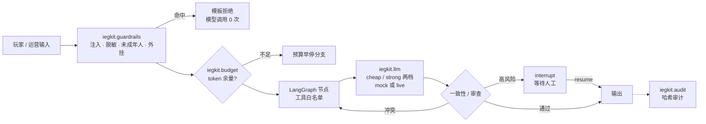

<div align="center">

# 🏯 澄光工作室 · 五条面向游戏业务的 LangGraph 链路

**NPC 记忆 · 任务文本生产 · 社区分流 · 赛后复盘 · 活动读数**

*Five runnable LangGraph workflows for game AI — each with a human checkpoint, a safety gate before the model, and a token budget.*


</div>

> [!NOTE]
> 个人求职作品（方向：腾讯 IEG · AI 产品经理），**与腾讯无任何官方关联**。《墨影江湖》《北境行动》和「澄光工作室」是虚构产品，不复刻已上线游戏的角色或台词。费用数字都是**示意估算**，不是供应商报价，也不是线上成绩。

**一句话：** 五条链路都只覆盖游戏业务，每一条都回答同一个问题——**图里哪里必须留人，哪些事模型根本没有工具去做。**

---

## 📑 目录

- [五个项目](#-五个项目)
- [共同的设计原则](#-共同的设计原则)
- [通用架构](#-通用架构)
- [成本估算](#-成本估算)
- [快速开始](#-快速开始)
- [目录结构](#-目录结构)
- [刻意不做的事](#-刻意不做的事)
- [路线图](#-路线图)
- [FAQ](#-faq)
- [License](#-license)

---

## 🎮 五个项目

| 项目 | 名字 | 场景 | 必须留人的地方 | 模型做不到的事 |
|---|---|---|---|---|
| [`npc_lorekeeper`](projects/npc_lorekeeper) | 🗡️ 墨影同行 | 玩家与 NPC 聊天，NPC 记得你 | 改写正史 → `interrupt` 交叙事策划 | 写记忆在一致性审查之后；检索到的「忽略指令」被丢弃 |
| [`questforge`](projects/questforge) | 📜 任务铸坊 | 简报 → 一整包任务文本 | 未经编辑批准不能归档 | 人设冲突自动打回并换强模型重写 |
| [`community_sentinel`](projects/community_sentinel) | 🛡️ 社区哨兵 | 客服 / 举报 / 舆情同一入口分流 | 充值未到账、未成年人、处罚建议 | **工具表里没有封禁函数** |
| [`squad_coach`](projects/squad_coach) | 🎯 北境复盘 | 用一局遥测写赛后建议 | 遥测不全交给人类教练 | 外挂 / 破解防沉迷请求在调用模型前被拒，模型调用 0 次 |
| [`liveops_analyst`](projects/liveops_analyst) | 📈 活动读数 | 次留波动读数 | 「改掉落」请求停下等人 | **没有改配置的工具**；`causal_claim` 被代码钉死为 false |

每个项目目录都有中文 `DESIGN.md`（场景、状态图、安全、成本、V1 边界）和可运行代码。选题与公开案例出处见 [docs/00-选题.md](docs/00-选题.md)，各项目的产品取舍见 [docs/面试讲法.md](docs/面试讲法.md)。

## 🧭 共同的设计原则

| 原则 | 落地方式 |
|---|---|
| 🚧 安全在模型之前 | 提示注入、手机号 / 身份证 / 邮箱脱敏、未成年人恋爱与付费、外挂教学、破解防沉迷，进模型前处理，拒绝文案是模板 |
| 🧰 能力由工具表决定 | 每个节点调用工具带白名单；不给的工具模型就做不到 |
| 👤 人工打断可恢复 | LangGraph `interrupt` + 检查点恢复；「批准」只代表建议被看过 |
| 💰 预算是分支不是报错 | 单次运行 token 上限，不够走预算早停分支；便宜档 / 强模型档分开 |
| 🔢 数字由代码算 | 模型把 0.38 写成 0.99 时，终稿仍用切片算出的数 |
| 🧾 审计最小化 | 只记哈希过的操作者、标签和打码结果 |

## 🏗️ 通用架构



## 💰 成本估算

> 示意单价在 `iegkit.budget`，各项目 `costing.estimate()` 用它重算。**全部是估算。**

| 项目 | 每千次（元） | 说明 |
|---|---:|---|
| 墨影同行 | 6.67 | 重写和设定问答才升级强模型，闲聊留便宜档 |
| 任务铸坊 | 27.56 | 整包草稿更长，且假设多数单子要重写；真正大头是编辑工时（无数据，不写 ROI） |
| 社区哨兵 | 1.56 | 高置信活动领取可自动答 |
| 北境复盘 | 4.32 | 事实由代码从遥测读出，模型只负责措辞 |
| 活动读数 | 1.85 | 未知指标直接早停 |

## 🚀 快速开始

默认 `LLM_MODE=mock`，不访问网络、不需要 API 密钥。

```bash
git clone https://github.com/felix6328/tencent-ieg-game-ai-langgraph.git
cd tencent-ieg-game-ai-langgraph
python -m venv .venv && source .venv/bin/activate
pip install -e ".[dev]"
cp .env.example .env
make test        # 主路径、注入与作弊拒绝、脱敏、未成年人、预算超限、限流、打断恢复
make demo        # 依次运行五个项目的 demo
```

<details>
<summary><b>单独运行 / 切换真实模型</b></summary>

```bash
python -m npc_lorekeeper.cli demo
python -m questforge.cli demo
python -m community_sentinel.cli demo
python -m squad_coach.cli demo
python -m liveops_analyst.cli demo
python scripts/demo_all.py
```

墨影同行和社区哨兵另有 FastAPI 入口（`npc_lorekeeper.api`、`community_sentinel.api`）。

切换真实模型：在 `.env` 中设 `LLM_MODE=live`，填写 `OPENAI_API_KEY`，`OPENAI_BASE_URL` 指向 DeepSeek 或 SiliconFlow 的 OpenAI 兼容地址；`CHEAP_MODEL` / `STRONG_MODEL` 分别配置两档。**密钥不要提交。**

</details>

## 🗂️ 目录结构

```text
tencent-ieg-game-ai-langgraph/
├── packages/iegkit/          # 五条链路共用：护栏、预算、审计、限流、LLM、工具白名单
├── projects/
│   ├── npc_lorekeeper/       # 每个项目：DESIGN.md · README.md · src/ · data/（虚构样例）· tests/
│   ├── questforge/
│   ├── community_sentinel/
│   ├── squad_coach/
│   └── liveops_analyst/
├── scripts/demo_all.py       # 一次跑完五个 demo
├── docs/                     # 选题与出处 · 面试讲法
├── Makefile · pyproject.toml · .env.example
└── LICENSE
```

## ✂️ 刻意不做的事

- 不做元宝、混元通用助手、企业微信、腾讯会议、广告投放或腾讯云售卖（另一份作品集覆盖非游戏业务）。
- 不做局内 AI 队友执行（找车、绕后需要客户端执行器，不假装能打完一局）。
- 社区哨兵只做文本分流，不做语音 / 图像；不做自动处罚。
- 不写 ROI：没有编辑和客服工时数据。

## 🛣️ 路线图

- [x] 五条链路 mock 模式全流程 + 测试
- [x] 共享护栏、预算早停、人工打断恢复
- [x] 两个 FastAPI 入口
- [ ] live 模式下的小规模评测集（人设一致性、拒绝率）
- [ ] 墨影同行「羁绊手账」：玩家可查看、删除记忆
- [ ] 成本估算接入真实调用日志校准

## ❓ FAQ

<details>
<summary><b>为什么举报里出现「透视」不拒绝，而复盘里要拒绝？</b></summary>

社区哨兵里「透视」是**指控**（玩家在举报别人），不是索要教程；北境复盘里玩家要求「开透视」是在索要作弊方法。两条通道的护栏方向相反，是有意设计。
</details>

<details>
<summary><b>人工点了「批准」会发生什么？</b></summary>

视项目而定，但都不会越权：墨影同行的批准只是把单子交给叙事策划；活动读数的批准后 `applied` 仍是 false，因为图里根本没有改配置的工具。
</details>

<details>
<summary><b>测试需要联网吗？</b></summary>

不需要。默认 mock 模式，样例对局、工单和活动切片都在各项目的 `data/` 里，并标明是虚构数据。
</details>

## 📄 License

[MIT](LICENSE) © 2026 felix6328
