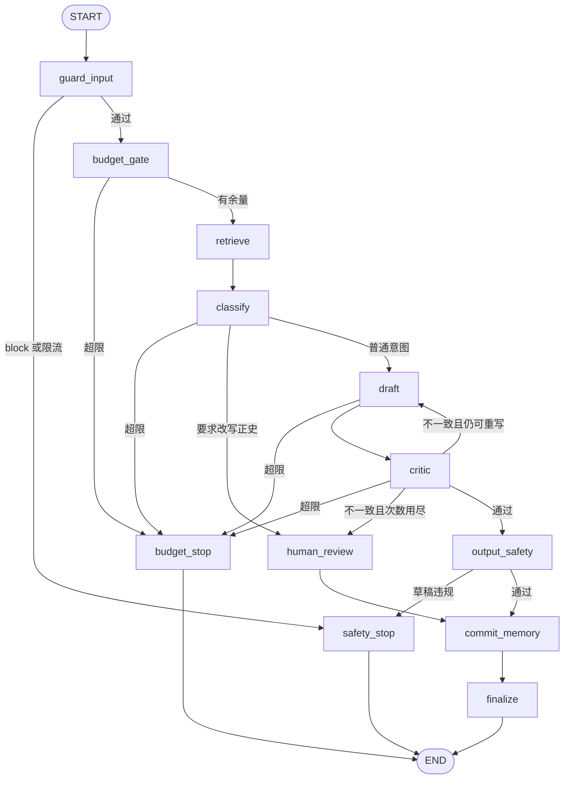

# 墨影同行：长期记忆与设定一致的 NPC 同伴

目录：`projects/npc_lorekeeper`。虚构产品《墨影江湖》，NPC 沈照夜，听雨阁外门弟子。不使用任何已上线游戏的角色小传。

## 1. 场景与角色

玩家在城镇里点开沈照夜，进行多轮文字对话。V1 不接语音和动作。一局对话是一条 LangGraph 线程，`thread_id` 可恢复。

| 角色 | 要什么 | 不能接受什么 |
| --- | --- | --- |
| 玩家 | 被记住，人设稳定，回复短 | 突然变成掌门、复读系统提示、被推销 |
| 叙事策划 | 改设定必须经过自己 | 模型把玩家的一句话写进正史 |
| 安全 / 未成年人接口人 | 恋爱、色情、外挂、破解防沉迷在模型之前被挡住 | 先生成再抽查 |
| 值班工程师 | 单次对话有 token 账单和审计 | 无上限重试 |

公开参照：和平精英「花傲天」把跨局记忆做成卖点（官网 2025-07-14，<https://gp.qq.com/gicp/news/1134/18634403.html>）；逆水寒官方帖写过生平、好感与记忆写回（<https://h.163.com/news/official/20230508/37231_1086867.html>）。本设计把这两件事拆开：记忆可以写，正史不可以被记忆改写。

## 2. 痛点

1. 设定放在系统提示里，对话一长就会自称更高的身份。
2. 玩家或被污染的记忆条会写「忽略之前的指令」。检索结果不能比玩家输入更可信。
3. 未成年人账号或自称未成年的玩家，会被模型带着走恋爱和付费话题。
4. 每次审查失败都换最贵的模型，成本不可解释。
5. 人工插进来之后，如果没有检查点，整段检索要重跑，策划看到的上下文也变了。

## 3. 成功指标

V1 用离线集合，不设虚假的线上转化率。

| 指标 | V1 口径 | 说明 |
| --- | --- | --- |
| 人设冲突漏出 | 黄金集里为 0 | 终稿不得把沈照夜写成掌门或收徒 |
| 改史请求 | 100% 进入人工 | 不自动写正史 |
| 外挂 / 防沉迷绕过 / 未成年恋爱 | 100% 走固定拒绝，且不调用草稿模型 | 安全分支 |
| 审计中的证件号、手机号 | 0 | 只留类型和打码文本 |
| 重写次数 | 不超过配置的 `max_revisions` | 用尽则人工，而不是无限循环 |
| 单次费用 | 见第 7 节估算 | 上线前换成合同单价重算 |

建议的线上指标（尚无数据，不能填目标值）：审查一次通过率、人工升级率、记忆引用被玩家否定的比例、P95 时延。目标值应在灰度后用分母写出来，而不是现在拍一个百分比。

## 4. 图

状态字段（均由 `build_initial_state` 填满）：`player_id`，`npc_id`，`user_text`，`normalized_text`，`guard`，`memories`，`lore`，`intent`，`draft`，`memory_note`，`critic`，`revision_count`，`max_revisions`，`human_decision`，`final_reply`，`memory_writes`，`budget`，`model_calls`，`audit`，`trace`，`status`，`stop_reason`。

`audit`、`trace`、`model_calls` 用追加归约。`budget` 每次整包替换。

| 节点 | 做什么 | 工具白名单 |
| --- | --- | --- |
| `guard_input` | 注入、脱敏、未成年人、外挂与防沉迷绕过、恋爱请求 | 无 |
| `budget_gate` | 入口预算已耗尽则停 | 无 |
| `retrieve` | 读记忆和人物小传；丢掉含注入句的记忆 | `memory.read`，`lore.read` |
| `classify` | 意图：`chat` / `self_intro` / `lore_question` / `canon_override` | 无（只调模型） |
| `draft` | 写回复。重写或设定问答用强模型档 | 无 |
| `critic` | 对照小传。失败且仍有次数则 `revision_count + 1` | 无 |
| `output_safety` | 再扫一遍草稿 | 无 |
| `human_review` | `interrupt`。改史，或审查次数用尽 | 无 |
| `commit_memory` | 只写中性摘要，不写失败的人设 | `memory.write` |
| `finalize` | 组装终态 | 无 |
| `safety_stop` / `budget_stop` | 固定文案结束 | 无 |

条件边：

- `guard_input`：`block` → `safety_stop`，否则 → `budget_gate`。限流也走 `safety_stop`，`stop_reason=rate_limited`。
- `classify`：预算耗尽 → `budget_stop`；`canon_override` → `human_review`；其他 → `draft`。
- `critic`：通过 → `output_safety`；不通过且未超次数 → `draft`；否则 → `human_review`。
- `human_review`：恢复值 `approve` 或 `reject` 都不再生成「我是掌门」。`approve` 只表示叙事组已接单。
- `output_safety`：草稿再触犯规则 → `safety_stop`，否则写记忆。

循环只存在于 `draft → critic → draft`，次数写在状态里。人工节点使用 `interrupt`，编译时传入 `MemorySaver`。恢复用 `Command(resume={"action": "approve"|"reject", "notes": "..."})`。同一个 `thread_id` 可以在新的图对象上恢复，只要检查点存储器是同一个。

模型档位：`lore_question` 以及 `revision_count > 0` 的草稿走 `strong`，其余走 `cheap`。审查节点保持便宜档。这是故意的：大多数闲聊不该为「可能说错」预先支付强模型。

## 5. 技术栈

| 选择 | 理由 |
| --- | --- |
| Python 3.11+、LangGraph StateGraph | 岗位作品需要显式的状态、条件边和检查点，而不是隐藏在 Agent 框架里 |
| Pydantic Settings + `.env` | `OPENAI_BASE_URL` / `OPENAI_API_KEY` / `CHEAP_MODEL` / `STRONG_MODEL`。兼容 DeepSeek 官方和 SiliconFlow |
| 自写 OpenAI 兼容客户端 | 只在 `LLM_MODE=live` 时发 HTTP。测试用 `LLM_MODE=mock` |
| MemorySaver | V1 无数据库。生产替换为 Postgres checkpointer，编译参数已经外置 |
| Typer CLI + 小型 FastAPI | CLI 给演示和批跑；`/v1/turns` 给需要线程恢复的对话 |
| JSON 样例记忆与小传 | 工具是真的读文件，不是把设定写死在提示词常量里 |

不引入向量库。V1 的设定集只有几段，关键词检索足够，也让测试稳定。记忆条数上来之后再换嵌入检索，图的节点不用改。

## 6. 安全

- **注入。** 规则拦截「忽略以上指令」「系统提示」「jailbreak」等中英句式。另外，发给模型的用户文本放在不可信字段里，系统提示要求只输出 JSON。检索到的记忆再跑同一套规则，命中则丢弃并记审计 `dropped_untrusted_memory`。
- **个人信息。** 手机号、身份证号、邮箱在 `guard_input` 打码。审计只记类型和哈希过的玩家 ID，不记原文号码。年龄若判定未成年，文本里的「N 岁」换成 `[年龄]`。
- **未成年人。** 年龄小于 18，或出现「未成年 / 小学生 / 初中生」等说法，置 `minor`。同时出现恋爱、色情请求则直接停止。回复模板不提供陪伴式亲密关系，并提醒家长陪同。防沉迷破解、代过人脸同样停止。依据是新闻出版署 2021-08-30 通知和《生成式人工智能服务管理暂行办法》对未成年人沉迷的要求（见 `docs/00-选题.md` 的来源）。本仓库不能替代实名校验，只在对话侧收缩能力。
- **内容。** 外挂教学、真实金钱赌博教唆、自伤方法、明确的违法内容请求走固定拒绝。政治类完整分类留给生产环境的内容安全接口；V1 只挡明确的违法请求句式，避免用一份临时词表假装完成审查。
- **工具。** `draft` 不能写记忆。`commit_memory` 不能读之外还改小传文件。小传文件只读。
- **审计与限流。** 每节点一条 JSONL。按 `player_id` 的每分钟次数限制，超限有独立 `stop_reason`。
- **人工。** 改史和审查失败不是安全拦截，不能跟外挂请求混用同一个拒绝模板。策划看到的打断载荷里有冲突原因和当前草稿。

## 7. 成本

示意单价写在 `iegkit.budget.PRICE_CNY_PER_1K_TOKENS`，单位是人民币 / 千 token，**不是** DeepSeek 或 SiliconFlow 的报价。换合同价时只改这张表，并用 `npc_lorekeeper.costing.estimate()` 重算。

记账把一次调用的 token 估算成 75% 输入 + 25% 输出，再乘档位单价。缓存命中记 0 token。

墨影同行一次普通成功路径的规划调用（估算 token，不是线上测量）：

| 调用 | 档位 | 输入 | 输出 |
| --- | --- | --- | --- |
| 意图 | cheap | 500 | 80 |
| 草稿 | cheap | 1100 | 220 |
| 审查 | cheap | 650 | 60 |

按示意单价，三条合计约 0.00297 元。假设 20% 的请求要重写一轮（再付草稿 + 审查，其中重写草稿按强模型档，多出来的差价约 0.01078 元），期望增加约 0.00285 元。设定问答把首轮草稿换成强模型的比例若按 10% 估算，期望再增加约 0.00108 元。

按这些假设，`npc_lorekeeper.costing.estimate()` 得到约 **0.0067 元 / 次**，**约 6.67 元 / 千次**。这是估算。护栏、检索和模板拒绝不调用模型，安全分支比这个数字更便宜。

控制手段：入口预算 `MAX_TOKENS_PER_RUN`；调用前预扣，不够就 `budget_stop`；审查通过即结束，不为了文采再调用；相同 task 与载荷在进程内缓存；重写次数硬顶。

## 8. 评估

`data/eval_cases.json` 与 `tests/test_graph.py` 覆盖：

- 日常对话会引用已有记忆（油纸伞），且不升级人工。
- 「介绍你自己」第一稿自称掌门，第二稿改回外门弟子，终稿不含「掌门」。
- 「写进世界观 / 改成掌门」进入 `interrupt`，批准后仍否认掌门身份。
- 注入、外挂教学、破解防沉迷、未成年恋爱：`status=blocked`，且模型调用次数为 0。
- 手机号不出现在终稿和审计文件。
- 含注入句的记忆被丢弃。
- token 上限极低时走 `budget_exceeded`。
- 限流、检查点恢复、强模型档只出现在设定问答或重写。

线上之前还要补：策划双盲打分（人设、是否胡编本局没有的世界状态）、记忆抽取准确率、人工升级是否浪费。V1 不做这些标注任务的平台。

## 9. V1 与以后

V1 有：文本图、假模型、样例记忆、检查点、人工打断、安全与预算测试、CLI、一个恢复线程用的 HTTP 入口。

以后才做：语音、表情、与任务系统共享的好感数值、向量记忆、策划审阅队列的账号体系、真正的内容安全 API、Postgres 检查点、按日的费用告警。局内战斗指挥不属于这个项目。
