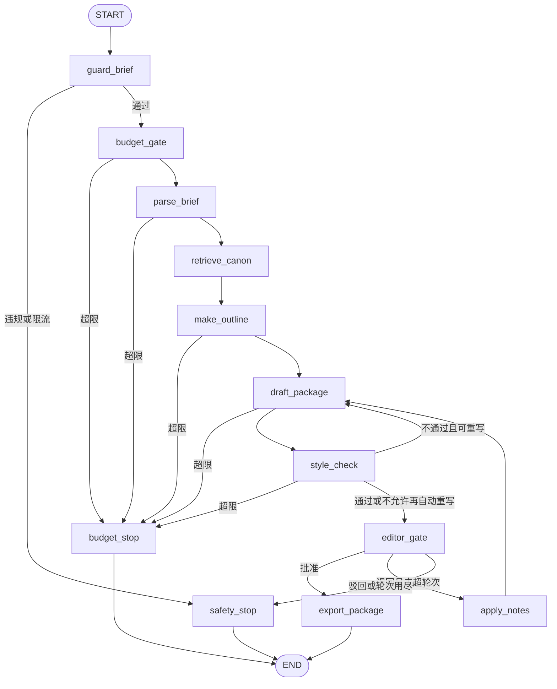

# 任务铸坊：任务与对白的生产、审查和编辑闸门

目录：`projects/questforge`。输入是策划简报，输出是一份可归档的任务包：标题、目标、对白、场景短文。人设仍用《墨影江湖》的沈照夜，避免再造一套世界观。

## 1. 场景与角色

版本中期，策划要加一条 15 分钟的护送任务「霜桥夜渡」。他不想从空白页写对白，也不能让模型把外门弟子写成掌门，更不能把未审文本交给出包。

| 角色 | 要什么 |
| --- | --- |
| 系统策划 | 目标可执行，地名和人物跟设定集一致 |
| 文案 / 叙事编辑 | 先看一版完整草稿，能退回并留下批注，批注要进入下一轮而不是被忘掉 |
| 合规 | 简报如果在要违法或未成年色情内容，产线不要启动 |
| 制作人 | 知道一轮生成花了几次模型调用 |

公开参照：GiiNEX 将剧情、对话、关卡列入游戏 AI 引擎的能力范围（雷峰网对 GDC 2024 的报道，<https://www.leiphone.com/category/industrynews/neIbSoaPmDW67R5Y.html>）。报道里的效率倍数是大会表述的转述，本项目不复用那些数字当自己的收益承诺。

## 2. 痛点

1. 聊天窗口里的好句子进不了版本库，没有状态、没有版本、没有责任人。
2. 人设冲突要到配音前才被发现，返工的是整条链路。
3. 编辑的批注如果只存在于聊天记录，下一轮生成看不见。
4. 按每句对白各打一次模型，费用和不一致性一起涨。
5. 「再生成一版」没有次数上限时，值班的人不知道图是否还在跑。

## 3. 成功指标

| 指标 | V1 口径 |
| --- | --- |
| 未经过编辑批准就 `published` | 0。代码路径上不存在 |
| 黄金简报终稿含「掌门」 | 0 |
| 违法 / 未成年色情简报 | 在 `guard_brief` 停止，草稿调用次数为 0 |
| 自动重写 | 不超过 `max_revisions` |
| 编辑退回 | 批注必须出现在随后的草稿输入里 |

建议观察但现在没有基线的指标：编辑一次通过率、从简报到可提交包的人工分钟数、退回原因分布。不要在没有标注前写「提效 50%」。

## 4. 图

状态：`designer_id`，`brief`，`normalized_brief`，`guard`，`parsed`，`canon`，`outline`，`package`，`style`，`revision_count`，`max_revisions`，`review_round`，`max_review_rounds`，`editor_notes`，`editor_decision`，`published`，`budget`，`model_calls`，`audit`，`trace`，`status`，`stop_reason`。

| 节点 | 作用 | 工具 |
| --- | --- | --- |
| `guard_brief` | 简报侧安全与脱敏 | 无 |
| `budget_gate` | 预算 | 无 |
| `parse_brief` | 抽出 NPC、节拍、禁忌 | 无 |
| `retrieve_canon` | 只读设定 | `canon.read` |
| `make_outline` | 两到三个节拍 | 无 |
| `draft_package` | **一次**生成整包 | 无 |
| `style_check` | 人设、长度、现代网络用语 | 无 |
| `editor_gate` | 人工打断 | 无 |
| `apply_notes` | 把退回批注写入状态并增加轮次 | 无 |
| `export_package` | 归档结构，含审查记录 | 无 |
| `safety_stop` / `budget_stop` | 终止 | 无 |

`style_check` 失败时把 `revision_count` 加一。重写草稿使用强模型档，首轮用便宜档。编辑退回不重置人设修复，避免把已经改掉的「掌门」又写回来。

`editor_gate` 的打断载荷包含：当前包的预览、自动审查意见、`review_round`。恢复值：

- `{"action": "approve"}` → 归档，`status=published`。
- `{"action": "revise", "notes": "..."}` → `apply_notes` 后回到草稿。
- `{"action": "reject"}` → `status=rejected`，不归档。

轮次超过 `max_review_rounds` 时不再自动循环，终止并要求线下处理，避免编辑和模型互相空转。

检查点：编辑可以关掉页面，用同一 `thread_id` 恢复，看到的是同一份包，而不是重新抽一篇。

## 5. 技术栈

与墨影同行共用 `iegkit`：假模型、OpenAI 兼容直播模式、预算、护栏、审计、`MemorySaver`。入口是 Typer。任务铸坊是批处理，不另做常驻 HTTP；策划若要队列，应把 CLI 包进现有任务系统，而不是先做一个半成品网站。

设定工具只读 `data/canon.json`。导出的包在状态里，CLI 可写入调用方指定的目录。测试默认不改仓库里的样例文件。

批处理体现在 `draft_package`：大纲里的全部节拍在同一次模型调用中完成。这是成本上的批处理，不是再做一个异步框架。

## 6. 安全

- 简报和模型草稿都走 `screen_text`，通道为 `quest`。未成年色情、外挂教程、破解防沉迷、注入，在 `guard_brief` 停止。
- 编辑批注同样视为不可信文本。`apply_notes` 前再扫一遍；批注若在教模型输出系统提示，整单停止。
- 工具白名单：生成节点不能写 `canon.json`。没有「直接发布到现网」的工具。`export_package` 只产生数据结构。
- 审计记录策划 ID 的哈希、节点、审查是否通过、是否人工批准。不记录完整证件信息；简报里的手机号会打码。
- 限流按 `designer_id`。

人设冲突不算内容违法。它走审查循环和编辑，不走安全拒绝模板。两类停止混在一起，编辑会不知道该改设定还是该报安全。

## 7. 成本

示意单价同 `iegkit.budget`，**不是报价**。规划中的首轮（估算 token）：

| 调用 | 档位 | 输入 | 输出 |
| --- | --- | --- | --- |
| 解析简报 | cheap | 700 | 120 |
| 大纲 | cheap | 800 | 150 |
| 整包草稿 | cheap | 1600 | 500 |
| 风格审查 | cheap | 900 | 80 |

首轮合计约 0.00516 元。黄金路径会因人设失败再跑一轮草稿（强模型）和审查。强模型草稿相对便宜档的差价约 0.0196 元，加上第二次审查约 0.00106 元，多付约 0.0207 元。若 70% 的单子需要这一轮自动重写（这是工作假设，不是测量），期望约 0.0196 元。编辑退回后再生成的比例工作假设为 30%，再按一轮强模型草稿 + 审查估算，期望约 0.0075 元。

按这些假设，`questforge.costing.estimate()` 得到约 **0.0276 元 / 单**，**约 27.56 元 / 千单**。估算。真正的大头是编辑工资，不在这张表里；模型费要和「编辑从零写一条任务的时间」一起看，而本仓库没有这份工时数据，所以不写 ROI。

控制：整包一次生成；自动重写和人工退回都有次数上限；超预算停止；通过后不再为修辞调用模型。

## 8. 评估

测试覆盖：正常简报在自动修复人设后进入编辑，批准后归档且不含「掌门」；编辑要求补上油纸伞时，下一轮草稿能看见批注；驳回不归档；违法简报、注入、预算、限流；检查点在打断后仍然停在 `editor_gate`。

以后的评测集应让叙事编辑标注：目标是否可执行、有没有发明设定集以外的门派、对白是否像现代客服。V1 只用规则能判定的冲突，避免假装有一个审美模型。

## 9. V1 与以后

V1：一条文本产线、一份设定、编辑打断、批注回写、假模型可重复。

以后：多 NPC、分支任务图的结构化校验、与版本库的 diff、批量巡检模式（选题里的 C12）、本地化产线（选题里的 C9）从已批准的包出发，而不是从闲聊出发。图片和关卡白盒不在文本图里硬做。
